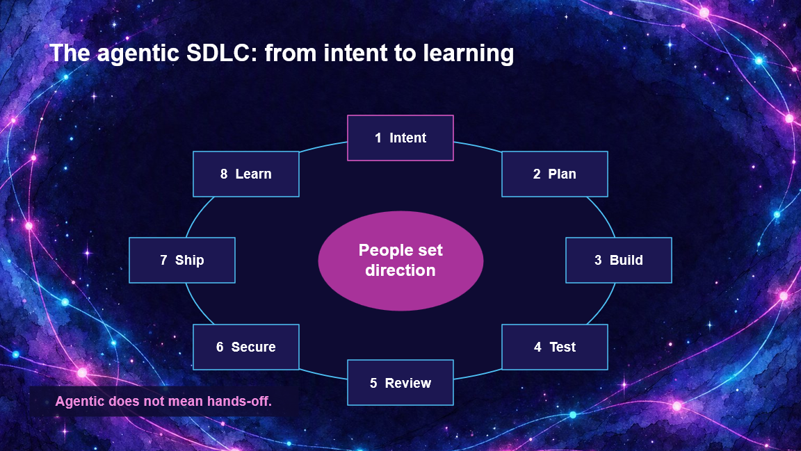

{ .hero }

# The agentic SDLC: from intent to learning

> People set direction. Agentic does not mean hands-off.

Software development has always been about more than writing code. It begins with understanding a need. Then we decide what good looks like, design, build, test, review, protect people and data, release, and learn from what happens.

Notice that the ring in the picture has no start line or finish line. The last step, *learn*, flows straight back into the first, *intent*. That is how real products grow.

## The eight steps

1. **Intent.** What are we trying to achieve, and for whom?
2. **Plan.** What is the path, and what does good look like?
3. **Build.** Create a first version.
4. **Test.** Find out what breaks, and for whom.
5. **Review.** Look again with fresh eyes.
6. **Secure.** Protect people, data and trust.
7. **Ship.** Put it in front of real people.
8. **Learn.** See what happened, then begin again.

## What "agentic" adds

An agentic lifecycle adds AI systems that can take on bounded, multi step work. An agent can inspect approved context, make a plan, use approved tools, produce an output, check its work and report back.

## What it does not mean

The word agentic does not mean hands-off. It means AI can help carry work across several steps while people remain responsible for **direction, constraints, decisions and approval**.

That is why the centre of the ring says *people set direction*. The agents travel around the ring. The humans hold the compass.
