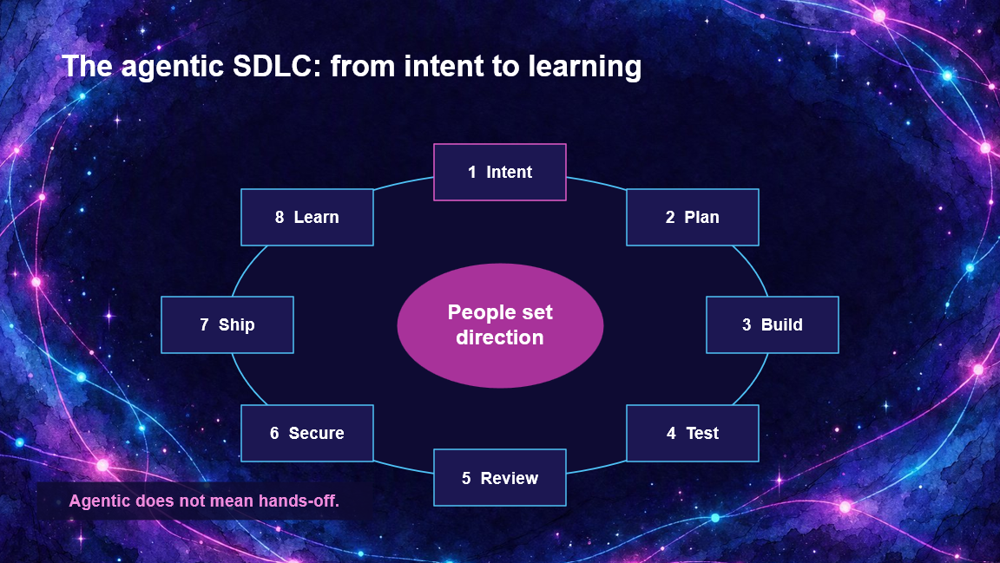

{ .hero }

# The agentic SDLC: from intent to learning

> People set direction. Agentic does not mean hands-off.

SDLC stands for the software development lifecycle. Please do not let the acronym scare you, **because you already know it.** If you were at Women in Tech WA, you were sitting inside one.

## You already know the eight steps

Think about the event itself.

1. **Intent.** Bring the women in tech of WA together.
2. **Plan.** Work out how.
3. **Build.** Speakers, venue, sessions.
4. **Test.** Run sheets and rehearsals.
5. **Review.** Look again with fresh eyes.
6. **Secure.** Protect registration details and everyone's safety in the room.
7. **Ship.** Open the doors on the day.
8. **Learn.** What worked, what did not, what to do better next year.

**That is not a software process. That is how anything worth building gets built.**

And look at the shape. It is a loop. It is our confidence loop (try, see, learn, try again), just with a few more steps.

## What "agentic" adds

An agent is AI that can take on **a bounded piece of work across several of these steps**. It can look at the context it is allowed to see, make a plan, use the tools it is allowed to use, produce something, check its own work and report back.

Which means the loop spins faster. Not just one first draft, but a first plan, a first set of tests, a first security check.

## Why people are in the middle

Look at the centre of the ring: **people set direction.** That is the answer to the fear of losing control.

A rocket can fly itself. **Mission control still decides where it is going.**

Agentic does not mean hands-off. **It means your hands are free for the parts only you can do:** deciding what matters, setting the boundaries, and saying "yes, ship it" or "no, not yet."

> The agents carry the work. You carry the purpose.

So let's meet the crew.
