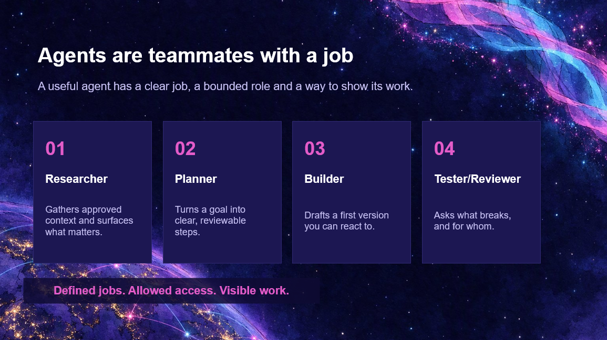

{ .hero }

# Agents are teammates with a job

> A useful agent has a clear job, a bounded role and a way to show its work.

On a space mission, nobody does everything. Every member of the crew has a job.

That is the best way to think about AI agents. **Not a magic button. A teammate, with a job.**

## Meet the crew

- **01 Researcher.** Gathers the context it is allowed to see and surfaces what matters.
- **02 Planner.** Turns a fuzzy goal into clear steps you can actually review.
- **03 Builder.** Drafts a first version you can react to. Remember the wireframe on the cliff? That is this one.
- **04 Tester or reviewer.** Asks what breaks, and **for whom**.

## For whom?

Those might be the two most important words here.

For decades, car crash-test dummies were built around the average man. It worked. **Just not for everyone.**

"It works" has too often meant "it works for the people who built it." A good testing agent asks the question that gets missed. What about someone on a slow connection? Using a screen reader? On their phone, on the bus?

## Three rules for every crew member

> Defined jobs. Allowed access. Visible work.

- **Defined**, because a vague agent produces vague results.
- **Allowed**, because you would not give a new starter the keys to the whole building on day one. Do not give an agent the keys either.
- **Visible**, because if a teammate will not show you what they did, they do not get the job. Same goes for agents.

But notice what is missing from this crew. **Nobody on it decides what matters.** That job is still ours.
