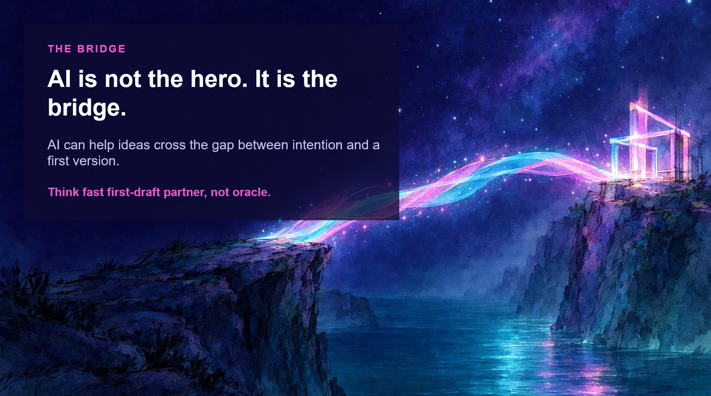

{ .hero }

# AI is not the hero. It is the bridge

> AI can help ideas cross the gap between intention and a first version.

There is a chasm between where an idea starts and where a first version stands. You are the one with the vision, the context and the care. AI is the bridge that makes the crossing shorter.

You are still the traveller. You still choose where to go. The bridge does not walk for you, but it does mean you no longer have to build the whole thing from scratch before you can take a step.

## What I mean by GitHub AI

I am not asking anyone to learn a new programming language. I mean AI capabilities, including GitHub Copilot and agentic experiences, that help people:

- explore a problem
- make a plan
- draft an artefact
- explain a decision
- create tests or documentation
- respond to feedback

## It is not only for coders

For a non coder, the artefact might be a journey map, a requirements list, a content structure, a test scenario or a prototype. Something real enough that another person can look at it and say, *yes, and what about this?*

## The right mental model

Not an oracle that knows the answer. A **fast first draft partner**.

An oracle asks for your trust. A draft partner asks for your judgment. That difference is everything, and it is the thread that runs through the rest of this story.
