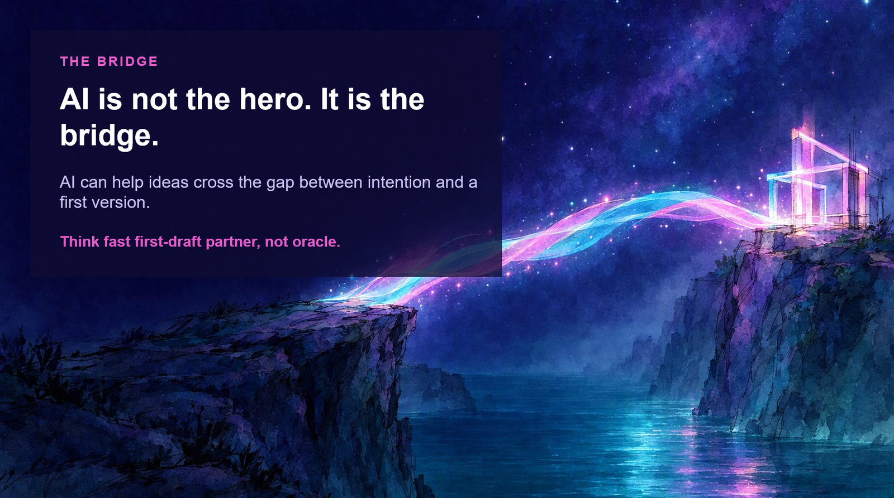

{ .hero }

# AI is not the hero. It is the bridge

> AI can help ideas cross the gap between intention and a first version.

Perspective is wonderful. But at some point, you have to come back down to earth and build something.

On the ground, the gap still looks like this. You on one side. Your idea on the other. And in between, deep water. You could dive it, mask on, in the dark. (You know how Michelle feels about that.)

At the start we said AI is not the hero of this story. Here is what it actually is. **It is the bridge.**

It does not drain the ocean. The gap is still real. **But you do not have to dive it anymore.**

## A first draft, not a finished building

Look at what is waiting on the far cliff. Not a finished building. A frame. A wireframe. **A first draft.**

That is the promise. Not perfection. A first version you can actually stand in, react to and improve.

## What I mean by GitHub AI

I am not asking anyone to learn a programming language. I mean tools like GitHub Copilot and AI agents that help you explore a problem, make a plan and draft something real.

For some people that is code. For others it is a journey map, a requirements list, a test scenario or a prototype. Something real enough that another person can look at it and say, *yes, and what about this?*

## Oracle or partner?

Do not treat it like an oracle. **An oracle gives you answers and expects you to believe them.**

Treat it like a fast first draft partner. **A partner gives you a draft and expects you to argue with it.**

> Don't ask AI to be right. Ask it to be fast. You be right.

Remember the loop? Try, see, learn, try again. This is what makes it spin faster: minutes to a first draft, instead of weeks.

But a bridge only matters if it takes you somewhere. So what does that journey look like?
