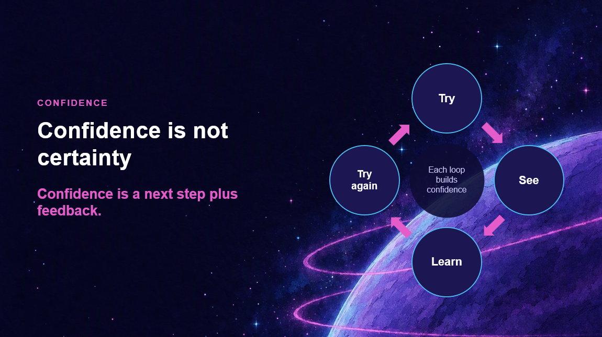

{ .hero }

# Confidence is not certainty

> Confidence is a next step plus feedback.

From the bottom of the ocean, we have jumped all the way into orbit.

Astronauts have a name for what happens up here. They call it **the overview effect**. You look back at the planet, the borders disappear, and everything that felt enormous on the ground suddenly looks small.

**From up here, you cannot see a single one of those doors.**

That is what confidence really is. **Not certainty. Perspective.**

## Nobody launches straight from the seabed

You do not get to orbit in one brave leap. You get there in loops.

1. **Try.** Take a sensible next step, however small.
2. **See.** Look honestly at what happened.
3. **Learn.** Notice what worked and what did not.
4. **Try again.** Go round once more, a little wiser.

A draft gives you something to question. A prototype gives you something to improve. Every loop gives you a little more perspective, until the things that stopped you start to look small.

## An orbit is just falling

Here is a bit of physics worth keeping. An orbit is just falling: falling forward so fast that you keep missing the ground. Over and over.

So every try that did not land perfectly? **That is not you failing. That is you staying in orbit.**

!!! tip "A small experiment"
    Think of something you are unsure about. Write down the smallest step that would teach you something. Then ask yourself, what would I see if I took it today?

And what if that loop could spin faster than ever before?
