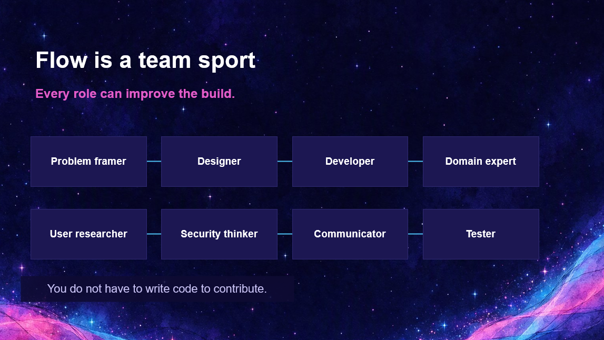

{ .hero }

# Flow is a team sport

> Every role can improve the build.

Twelve people have walked on the moon. Around **four hundred thousand people** worked on the Apollo program that got the first ones there.

Engineers, seamstresses, mathematicians, programmers, technicians. **Margaret Hamilton**, leading the team that wrote the flight software. **Katherine Johnson**, whose maths helped get them there and back.

**One small step. Four hundred thousand pairs of hands.**

## Eight ways to contribute

Look at the roles in the picture. "Developer" is just one box out of eight.

- **Problem framer.** Names what is really going wrong.
- **Designer.** Shapes how it feels to use.
- **Developer.** Turns the shape into something that works.
- **Domain expert.** Knows what is true in the real world.
- **User researcher.** Brings the voices of the people it is for.
- **Security thinker.** Asks what could go wrong, and who it could hurt.
- **Communicator.** Makes it understandable and welcoming.
- **Tester.** Finds what the rest of us missed.

Can you see yourself somewhere here? Now, do you write code? If not, you are still on this list. **Every one of those roles improves the build.**

## You do not have to write code to contribute

You can frame the problem. Bring the real examples. Describe what good looks like. Check the language. Notice who has been left out. Ask the one question that stops a team building the wrong thing.

## Flow lives in the handoffs

Look at the lines between the boxes. **That is where flow actually lives. Not in the boxes. In the handoffs.**

Flow is not one person moving faster on their own. It is a team making the next handoff easier.

And that is exactly where AI helps. **It does not replace the boxes. It makes the lines shorter.**

When a whole team can move this fast, we need to talk about how we move safely.
