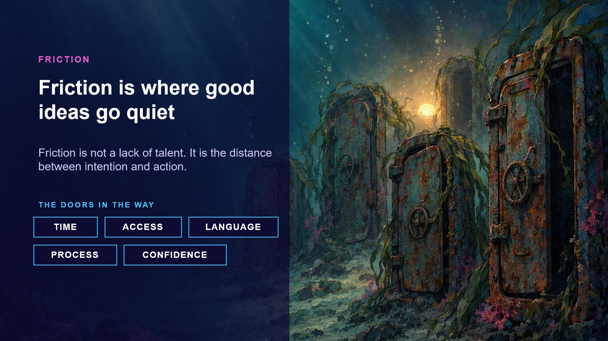

{ .hero }

# Friction is where good ideas go quiet

> Friction is not a lack of talent. It is the distance between intention and action.

Down here, at the bottom of the deep, is where ideas end up.

Look at the light behind the doors. That is an idea. **It is still glowing. Nobody switched it off. It just got stuck.**

## The five doors

- **Time.** *"I'll get to it after this quarter."*
- **Access.** *"I don't have the tools. Or the permission."*
- **Language.** Everyone is saying API and LLM and SDLC, and you are nodding along.
- **Process.** Fourteen steps between your idea and anyone actually seeing it.
- **Confidence.** *"Who am I to build this?"*

Notice something. **Confidence is only one of five doors.** So if your idea is stuck, it is very often not you. **It is the doors.**

## A question for the room

Who here has an idea waiting behind one of these doors?

Keep your hand up if it has been waiting more than a year.

Look around. That is a room full of ideas, glowing in the deep. You are not alone.

And look at the rust on those doors. **Doors do not rust from being opened. They rust from waiting.**

So let's start with the heaviest door: confidence.
