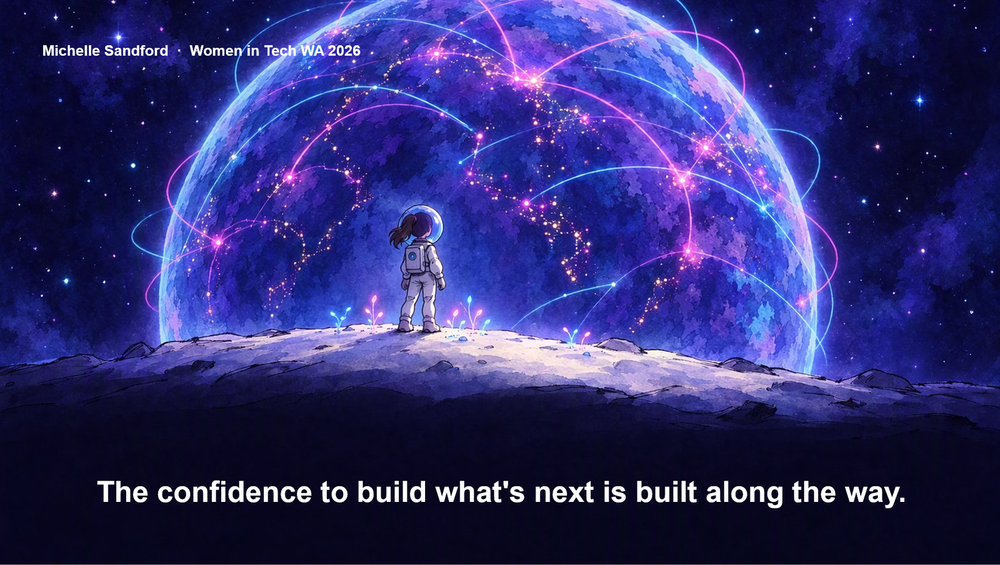

{ .hero }

# Go build what's next

> The confidence to build what's next is built along the way.

We started at the bottom of the ocean. A little diver, in a mask. Michelle's worst nightmare.

We went past the rusty doors. Up into orbit. Across the bridge.

**And here she is.** Standing on her own two feet, looking at that lit-up world.

And yes, she is still wearing the helmet. The fear did not disappear. **She just stopped letting it decide.**

Look at her feet. **Things are growing.** Small things. First versions. That is where confidence comes from. Not before you start. Along the way.

## What you can carry with you

- You do not need to know everything before you begin.
- You do not need to become someone else before your idea deserves a first version.
- And you do not need to build alone.

## Bring the whole of yourself

Bring the question. Bring the context. Bring the care.

Use AI to fill the blank page. And use your judgment to decide what belongs on it.

## One last thought

AI is going to change how we build. But it does not get to decide who builds what's next.

**We do.**

The confidence to build what's next is not the price of admission. It is what we build, together, along the way.

So. **Helmet on. Hands on the controls. Go build what's next.**

[Explore the resources](resources.md){ .md-button .md-button--primary }
