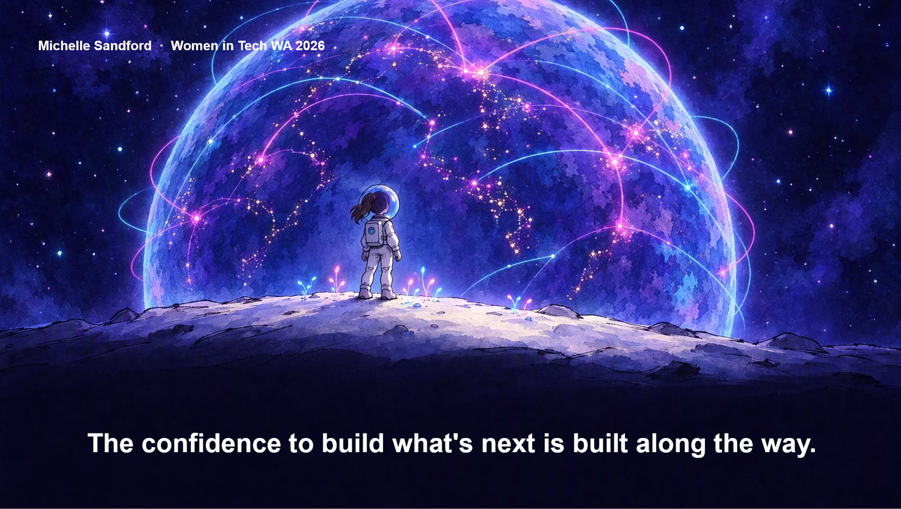

{ .hero }

# The future is not something we wait for

> The confidence to build what's next is built along the way.

We began under the water, with a small explorer drifting upward toward a sky of connected lights. We end on solid ground, under that same sky, with the whole dome of possibility above us.

The journey was never about waiting for the future to arrive. It was about finding that we already stand inside it.

## What you can carry with you

- You do not need to know everything before you begin.
- You do not need to become someone else before your idea deserves a first version.
- You do not need to build alone.

## Bring the whole of yourself

Bring the question. Bring the context. Bring the care.

Use AI to reduce the blank page, and use your judgment to decide what belongs on it.

## One last thought

The confidence to build what is next is not the price of admission.

It is what we build, together, along the way.

Thank you for reading, and for being brave enough to begin.

[Explore the resources](resources.md){ .md-button .md-button--primary }
