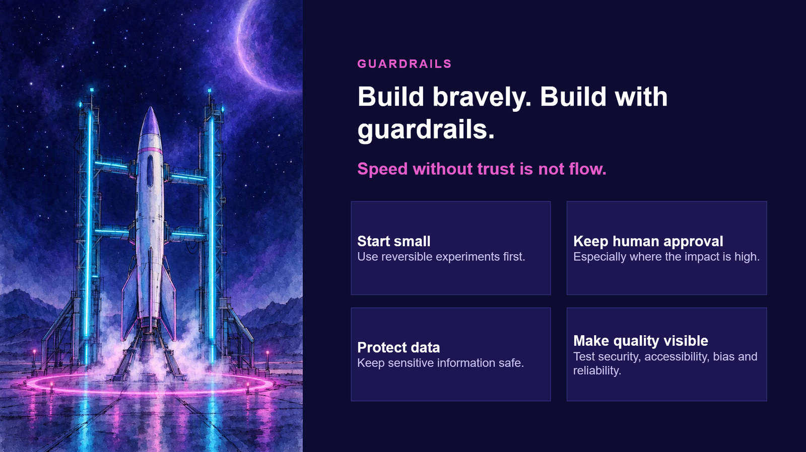

{ .hero }

# Build bravely. Build with guardrails

> Speed without trust is not flow.

What Michelle actually feared about diving was never the water. **It was the loss of control.**

And here is what she learned. **Divers do not go deep because they are fearless. They go deep because they trust the system that brings them back.** Check your gear. Never dive alone. Come up slowly. That is what gives you control back.

Look at the rocket. Nobody thinks the launch tower slows it down. **The tower is the reason it gets to launch at all.**

Responsible building is not the opposite of bold building. It is what lets bold building last.

Why do cars have brakes? **So they can go fast.**

## Four guardrails

1. **Start small.** Use reversible experiments. Test in the shallow end first.
2. **Keep human approval,** especially where the impact is high. Before every launch there is a go or no-go call, and every controller, one at a time, has to say "Go." **Agents can do the work. A human still says "Go."**
3. **Protect data.** Behind every record is a real person who trusted you with it.
4. **Make quality visible.** Test for security, accessibility, bias and reliability. Remember the crash-test dummy, and ask every time: **good enough for whom?**

## The better question

The question was never only *can AI do this?*

It is also:

- *Should it?*
- *Under what conditions?*
- *And who reviews the result?*

> Speed without trust is not flow. It is just a faster way to crash.

So, what can you actually do on Monday?
