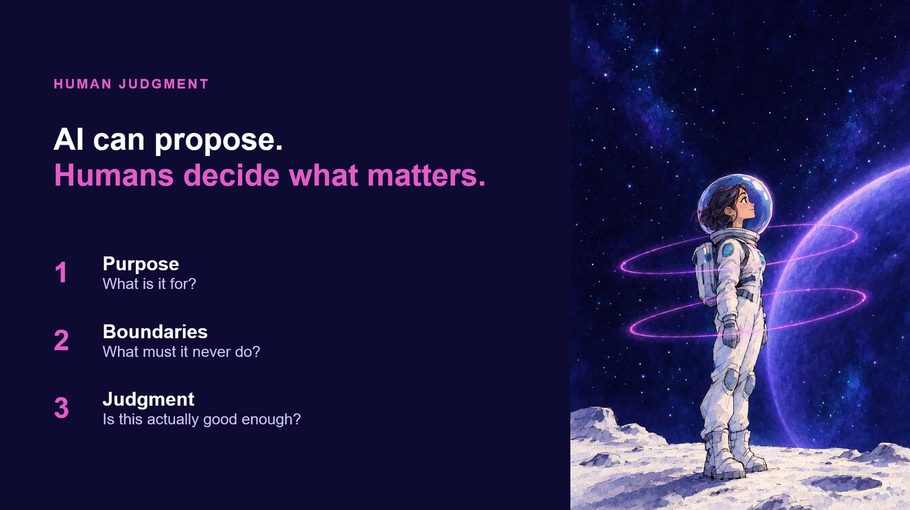

{ .hero }

# AI can propose. Humans decide what matters

> AI can propose. Humans decide what matters.

Remember the little diver from the very first slide, deep in the water, looking up at the light?

**Look where she ended up.**

Yes, she is wearing a helmet. But look at her face. She is not trapped. She is looking up, because she knows who is in control.

And look at those rings. On the confidence slide, they circled the planet. **Now they circle her.** The bridge, the loop, the crew: this is what it all orbits around. **You.**

## Three questions AI cannot answer for you

1. **Purpose.** What is this actually for?
2. **Boundaries.** What must it never do?
3. **Judgment.** Is this actually good enough? And good enough **for whom?**

## Who isn't this dummy?

You could run a million perfect tests on a crash-test dummy, and every single one would pass. It took a human to ask the real question: **who isn't this dummy?**

That is judgment, and it comes from people. The person who notices the accessibility issue. The person who sees who is missing from the data. The person who knows what actually happens in the real world, not just in the plan.

## Why diverse teams matter more now

> When producing gets cheap, judgment gets precious.

AI makes it easier to produce more. That does not make human judgment less important. It makes it more important than it has ever been.

**The more AI can do, the more it matters who is in the room.** Your experience, your perspective, the questions you ask that nobody else thought to ask: that is not a nice-to-have in the age of AI. **That is the whole point.**
