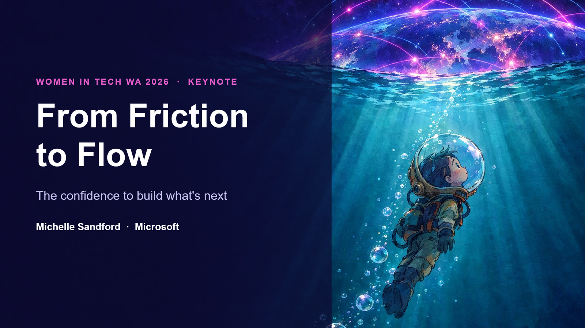
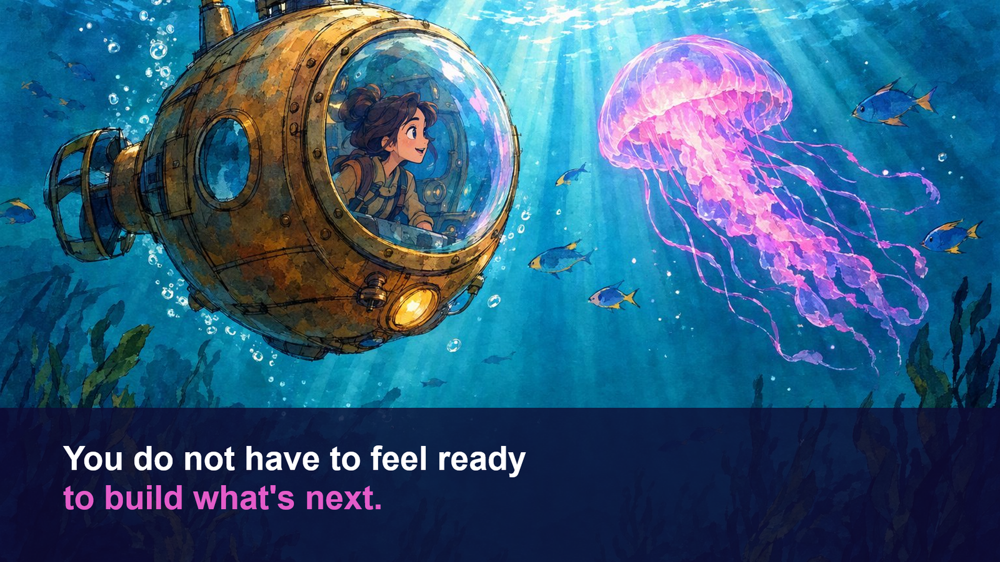
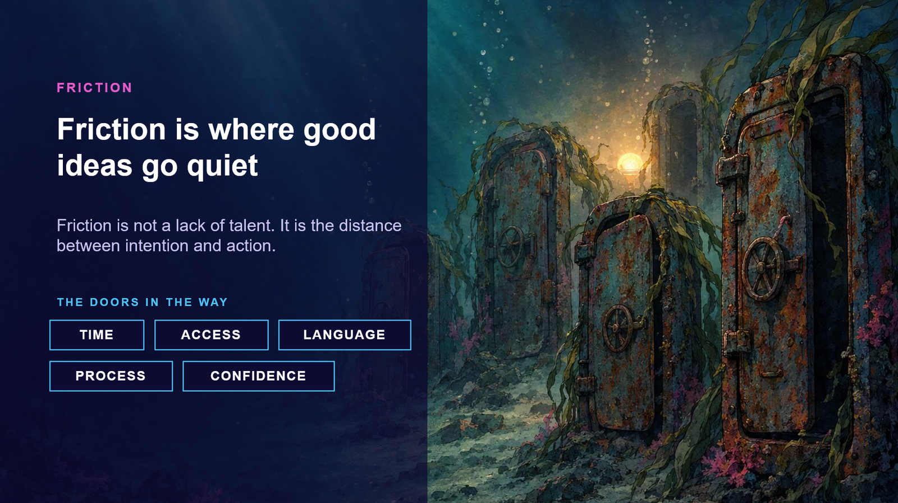
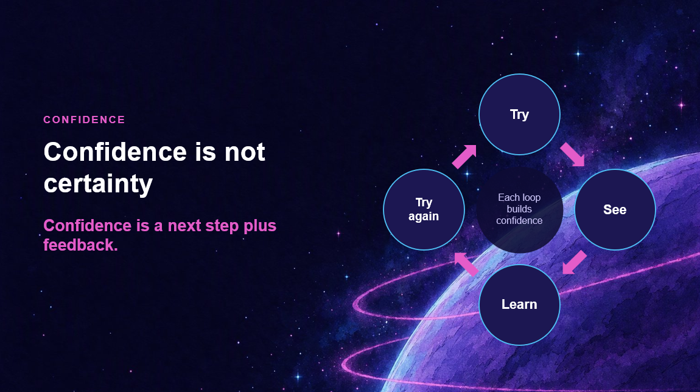
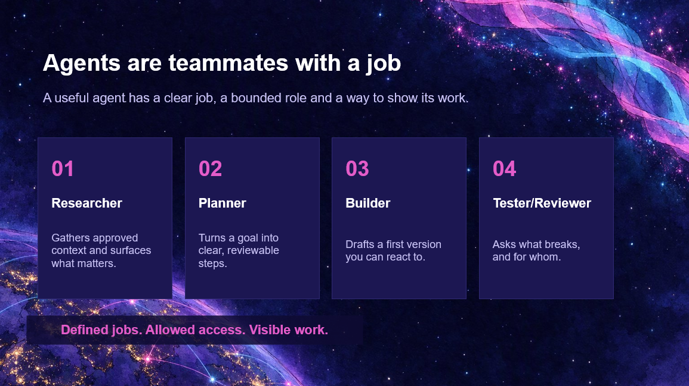
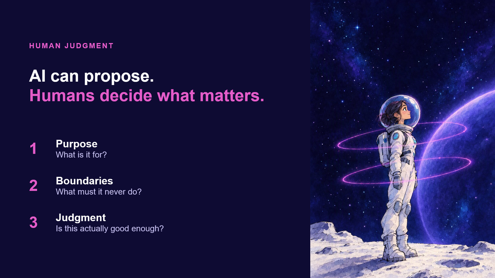
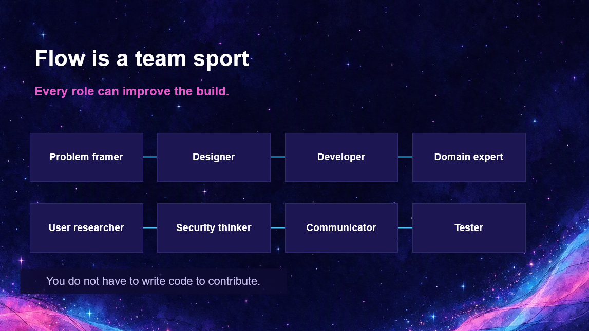
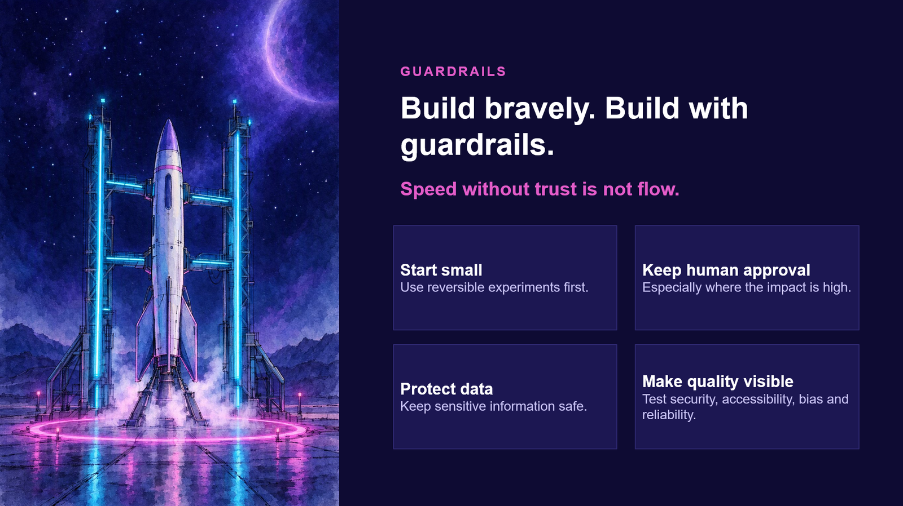
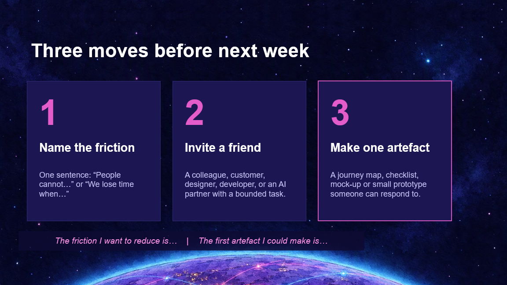

{ .hero }

# From Friction to Flow

**The confidence to build what's next**

*Women in Tech WA 2026 Keynote by Michelle Sandford, Microsoft*

Welcome. This is the companion site to the keynote. It is a story told in twelve short chapters, each one matching a slide from the talk. Read them in order, or jump straight to the one that speaks to you.

You do not need to be a programmer to be here. You only need an idea that is still waiting for its first version.

[Start with chapter one](ready.md){ .md-button .md-button--primary }
[Jump to the resources](resources.md){ .md-button }

## The journey at a glance

Friction, then confidence, then a bridge, then flow, then human judgment, then action. Pick any chapter below.

<ul class="thumb-grid">
  <li><a href="ready/"><small>Chapter 1</small>You do not have to feel ready</a></li>
  <li><a href="friction/"><small>Chapter 2</small>Friction is where good ideas go quiet</a></li>
  <li><a href="confidence-not-certainty/"><small>Chapter 3</small>Confidence is not certainty</a></li>
  <li><a href="bridge/"><small>Chapter 4</small>AI is not the hero. It is the bridge</a></li>
  <li><a href="agentic-sdlc/"><small>Chapter 5</small>The agentic SDLC</a></li>
  <li><a href="agents/"><small>Chapter 6</small>Agents are teammates with a job</a></li>
  <li><a href="human/"><small>Chapter 7</small>The human is the source of meaning</a></li>
  <li><a href="story/"><small>Chapter 8</small>The idea that became tangible</a></li>
  <li><a href="flow/"><small>Chapter 9</small>Flow is a team sport</a></li>
  <li><a href="guardrails/"><small>Chapter 10</small>Build bravely with guardrails</a></li>
  <li><a href="three-moves/"><small>Chapter 11</small>Three moves before next week</a></li>
  <li><a href="future/"><small>Chapter 12</small>The future is not something we wait for</a></li>
</ul>

## Jump links

<ul class="jump-links">
  <li><a href="ready/">1 Ready</a></li>
  <li><a href="friction/">2 Friction</a></li>
  <li><a href="confidence-not-certainty/">3 Confidence</a></li>
  <li><a href="bridge/">4 Bridge</a></li>
  <li><a href="agentic-sdlc/">5 SDLC</a></li>
  <li><a href="agents/">6 Agents</a></li>
  <li><a href="human/">7 Human</a></li>
  <li><a href="story/">8 Story</a></li>
  <li><a href="flow/">9 Flow</a></li>
  <li><a href="guardrails/">10 Guardrails</a></li>
  <li><a href="three-moves/">11 Three moves</a></li>
  <li><a href="future/">12 Future</a></li>
  <li><a href="resources/">Resources</a></li>
</ul>
