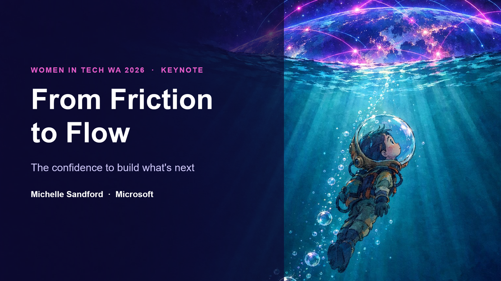{ .hero }

# From Friction to Flow

**The confidence to build what's next**

*Women in Tech WA 2026 Keynote by Michelle Sandford, Microsoft*

Look at the little diver in the picture. Helmet sealed. Heavy suit. Every breath coming through a tube.

For Michelle, that picture is a worst nightmare. Not the water, but the mask: the enclosed space, the feeling of losing control. And that is how a lot of people feel about AI right now. **It is not the technology that scares us. It is the feeling of losing control.**

Most ideas do not die from a lack of talent. They drown in friction. But look again. This diver is not sinking. She is swimming up, toward the light.

Brave is not the absence of fear. Brave is going in anyway.

This is not a story about AI. **AI is not the hero of this story. You are.** Because the future is not built by the people who felt ready. It is built by the people who started anyway.

This is the companion site to the keynote. It is a story told in twelve short chapters, each one matching a slide from the talk. Read them in order, or jump straight to the one that speaks to you.

You do not need to be a programmer to be here. You only need an idea that is still waiting for its first version.

[Start with chapter one](ready.md){ .md-button .md-button--primary }
[Jump to the resources](resources.md){ .md-button }

## The journey at a glance

From the deep water to the submarine you steer, past the rusty doors, up into orbit, across the bridge, around the agentic loop, with the crew, onto the moon, to the wall of ideas, the team, the launch pad and the lit-up world. Every step answers the same fear the same way: **you stay in control.** Pick any chapter below.

<ul class="thumb-grid">
  <li><a href="ready/">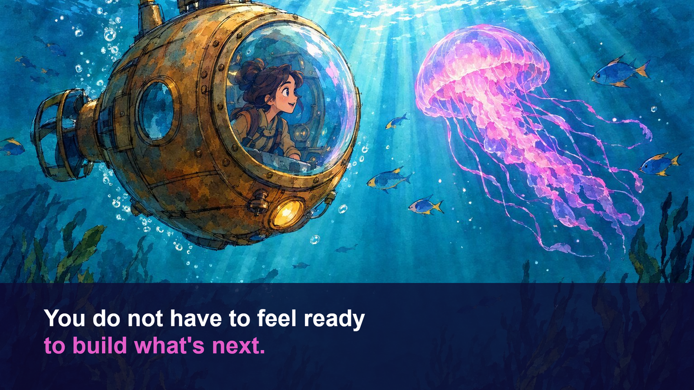<small>Chapter 1</small>You do not have to feel ready</a></li>
  <li><a href="friction/">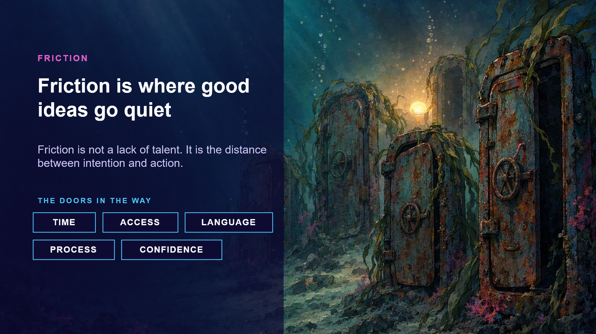<small>Chapter 2</small>Friction is where good ideas go quiet</a></li>
  <li><a href="confidence-not-certainty/">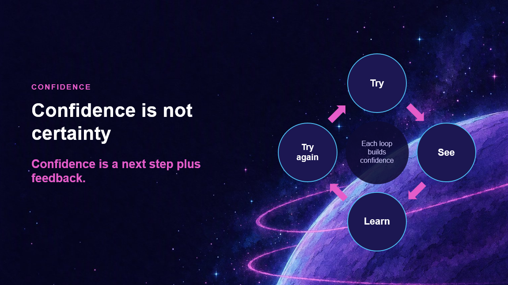<small>Chapter 3</small>Confidence is not certainty</a></li>
  <li><a href="bridge/">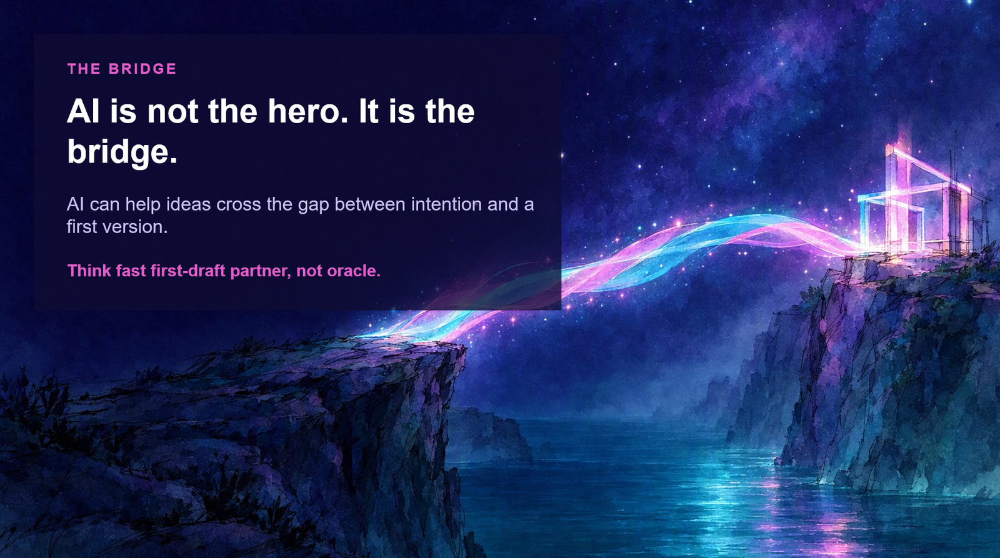<small>Chapter 4</small>AI is not the hero. It is the bridge</a></li>
  <li><a href="agentic-sdlc/">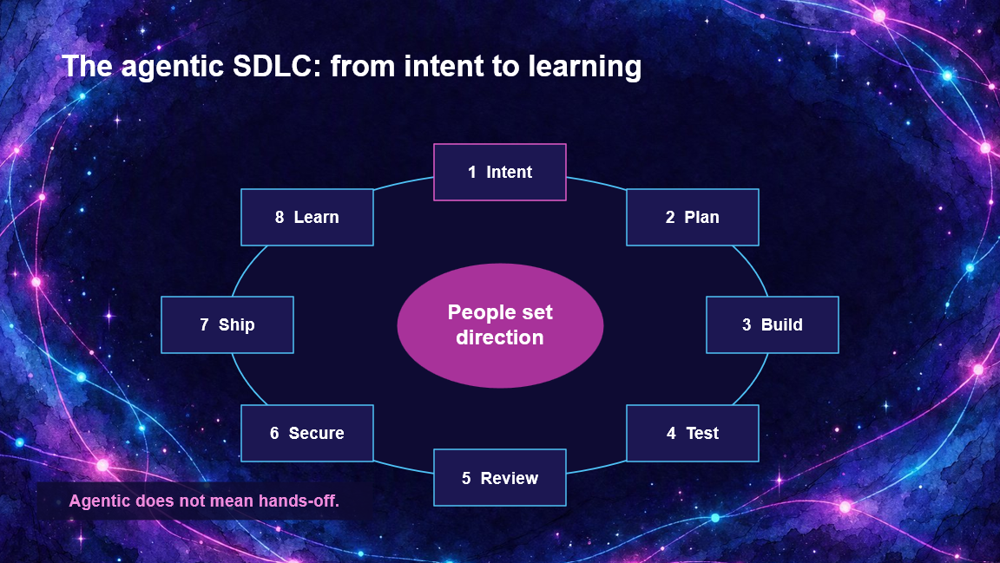<small>Chapter 5</small>The agentic SDLC</a></li>
  <li><a href="agents/">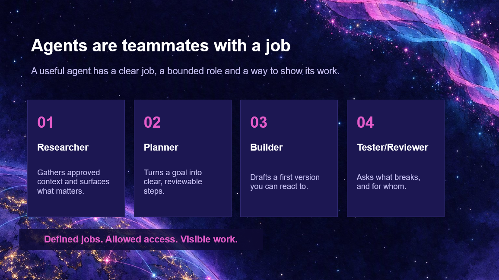<small>Chapter 6</small>Agents are teammates with a job</a></li>
  <li><a href="human/">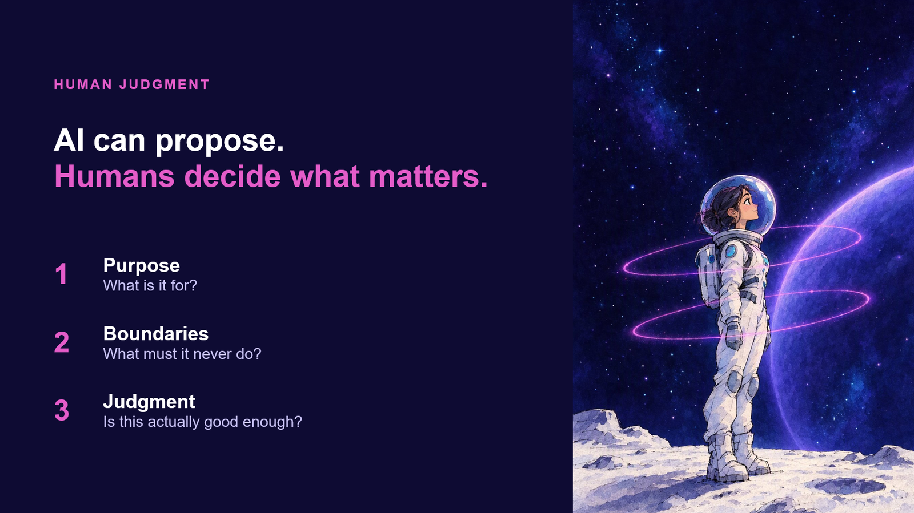<small>Chapter 7</small>AI can propose. Humans decide what matters</a></li>
  <li><a href="story/">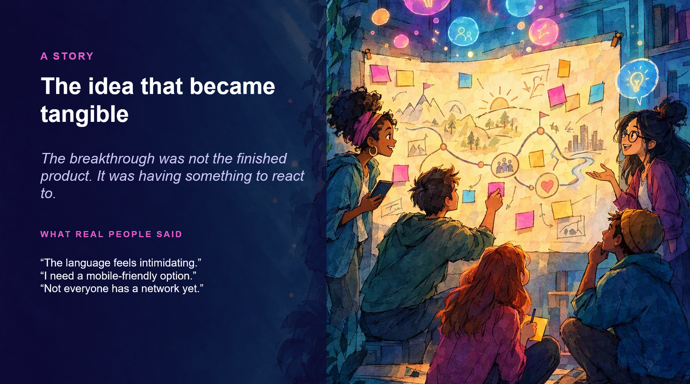<small>Chapter 8</small>The idea that became tangible</a></li>
  <li><a href="flow/">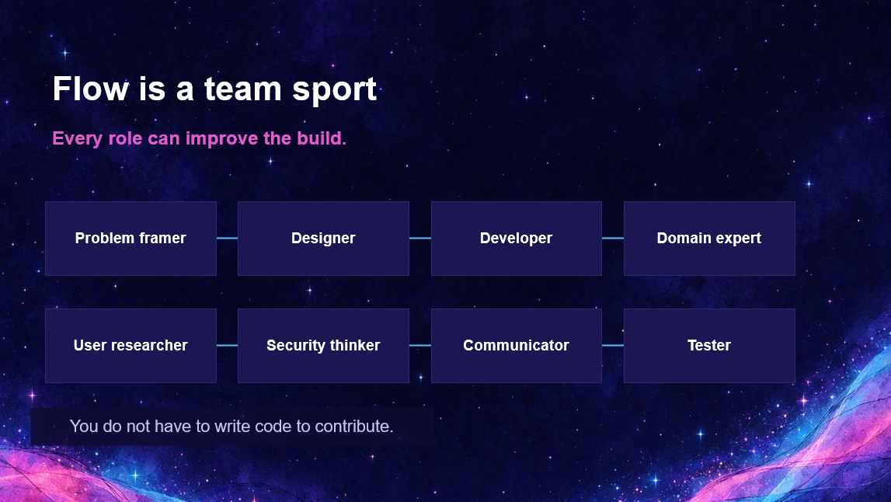<small>Chapter 9</small>Flow is a team sport</a></li>
  <li><a href="guardrails/">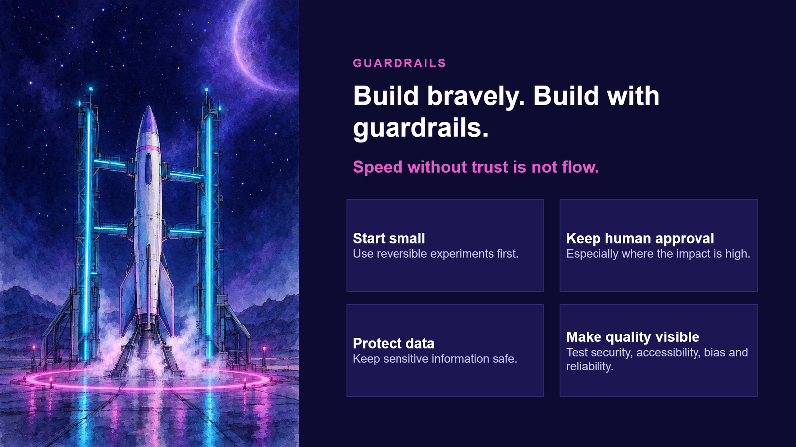<small>Chapter 10</small>Build bravely with guardrails</a></li>
  <li><a href="three-moves/">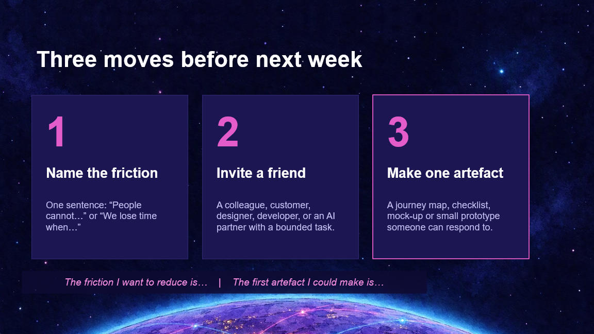<small>Chapter 11</small>Three moves before next week</a></li>
  <li><a href="future/">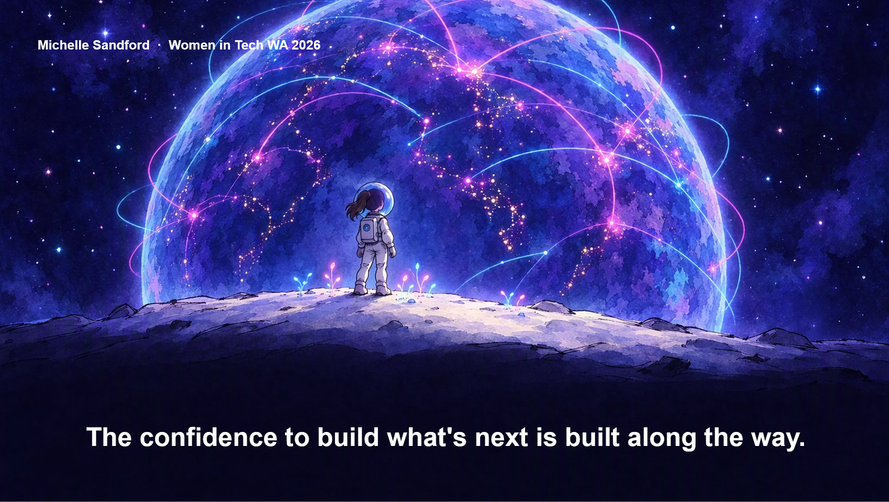<small>Chapter 12</small>Go build what's next</a></li>
</ul>

## Jump links

<ul class="jump-links">
  <li><a href="ready/">1 Ready</a></li>
  <li><a href="friction/">2 Friction</a></li>
  <li><a href="confidence-not-certainty/">3 Confidence</a></li>
  <li><a href="bridge/">4 Bridge</a></li>
  <li><a href="agentic-sdlc/">5 SDLC</a></li>
  <li><a href="agents/">6 Agents</a></li>
  <li><a href="human/">7 Human</a></li>
  <li><a href="story/">8 Story</a></li>
  <li><a href="flow/">9 Flow</a></li>
  <li><a href="guardrails/">10 Guardrails</a></li>
  <li><a href="three-moves/">11 Three moves</a></li>
  <li><a href="future/">12 Go build</a></li>
  <li><a href="resources/">Resources</a></li>
</ul>
