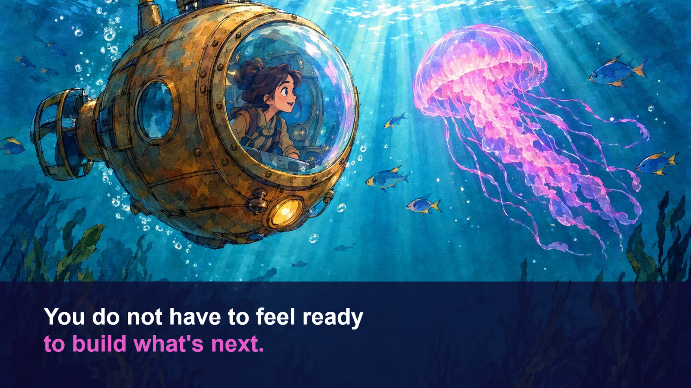

{ .hero }

# You do not have to feel ready

> You do not have to feel ready to build what's next.

You would think someone afraid of masks and enclosed spaces would find a submarine even worse.

But look at the difference. Same deep water. Same enclosed space. Yet the explorer inside is not trapped. **She has the biggest window in the ocean.** She can see exactly where she is going. **And she is the one steering.**

She is not frozen. She is curious. She is smiling. She is close enough to see the jellyfish.

Here is the thing about fear. **It shrinks when you can see out, and you are the one in control.**

## What this talk is, and is not

This is not a talk about becoming a programmer in twenty five minutes. You do not have to become someone else before your idea deserves a first version.

It is about what happens when the distance between an idea and a first useful version gets smaller. The tools we have now, GitHub Copilot and AI agents, **are not asking you to hand over control.** Used well, they are the submarine: a window you can see through, and controls you keep your hands on.

**You do not need to stop being afraid. You need to be the one steering.**

## Try this

Think of one thing you have been waiting to feel ready for. Hold it lightly. By the end of these chapters, you will have a small, practical way to begin.

And if talent is not what is stopping us, what is? Turn the page.
