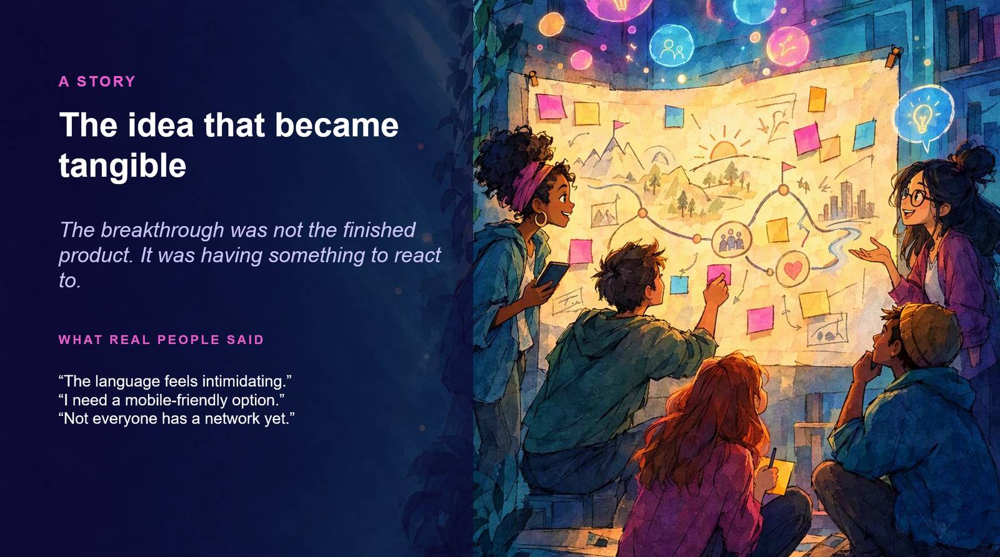

{ .hero }

# A story: the idea that became tangible

> The breakthrough was not the finished product. It was having something to react to.

Let me tell you about a community organiser. She has been in the industry for years, and she sees something others miss: people new to tech do not struggle to find mentors because mentors are scarce. They struggle because nobody has shown them how to begin the conversation.

She has the insight. She has the relationships. What she does not have is a product team, or weeks to build something.

!!! note "A story to make your own"
    This is an illustrative story. In the live keynote, it is replaced with a true story from real work, community or customer experience.

## The first conversation

She starts simply. *Help me map the journey from wanting a mentor to having a useful first conversation.*

With AI as a draft partner, she gets a journey map, a list of questions and a rough first version within the hour. It is not perfect. It is not even finished. But for the first time, her idea exists outside her own head.

## Then real people react

She shows it to the people it is for. Their reactions are gold.

- One says the language feels intimidating.
- Another needs a mobile friendly option.
- Someone else points out the idea assumes people already have a professional network.

Each comment is a door she could not see from the inside.

## What changed

The first version did not prove the idea was finished. It made learning possible. It turned private confidence into **shared progress**.

That is the whole point of this talk. You do not need the answer. You need something real enough for someone to respond to.
