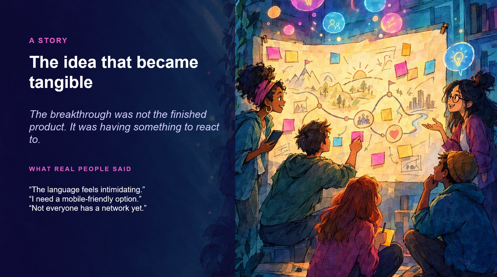

{ .hero }

# A story: the idea that became tangible

> The breakthrough was not the finished product. It was having something to react to.

Remember the light stuck behind those rusty doors? **This is what it looks like when it gets out.**

Picture a community organiser. She wants to help people who are new to tech find a mentor. She has the insight. She has the relationships. What she does not have is a product team, or a spare six weeks.

So the idea sits behind the doors. Time. Access. Process.

!!! note "A story to make your own"
    This is an illustrative story. In the live keynote, it can be replaced with a true story from real work, community or customer experience.

## The first conversation

One evening, she opens a conversation with AI and types one sentence. *Help me map the journey from wanting a mentor to having a useful first conversation.*

Within the hour she has something she did not have before: a journey map, a set of questions and a rough first version. Not finished. Not perfect. **A wireframe on the cliff.**

## Then she does the bravest thing

She shows it to real people. And real people react.

- *"The language feels intimidating."*
- *"I need a mobile-friendly option."*
- *"Not everyone has a network yet."*

That last one stops her, because her whole idea quietly assumed people already had one. **That is the crash-test dummy, all over again.** And it took a human in the room to see it.

## What changed

Her first version did not prove the idea was finished. **It made learning possible.**

Nobody can give you feedback on an idea that lives in your head. **An idea in your head stays safe. An idea on the wall gets better.**

That is what a first draft really does. It turns private confidence into **shared progress**.

And notice who made it better. Not the AI. **The people around the wall.** Which tells you something important about flow.
