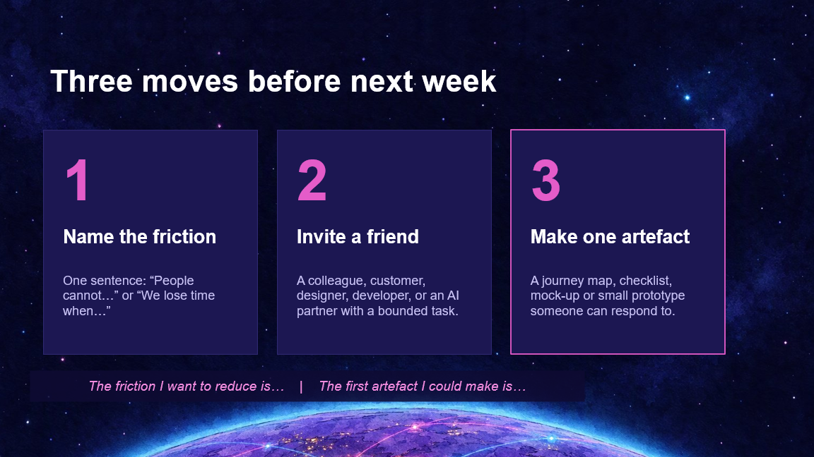

{ .hero }

# Three moves before next week

> Name the friction. Invite a friend. Make one artefact.

Look at the bottom of the picture. Recognise it? That is the lit-up world from the very first slide, the one the little diver was swimming towards.

So let's talk about how you get there. Not someday. **Before next week.** Three moves, and every one of them keeps you in control.

## 1. Name the friction

Say it in one sentence.

- *People cannot...*
- *We lose time when...*

You cannot fix what you have not named. And once it is named, it is already smaller.

## 2. Invite a friend

Remember the diving rule? **Never dive alone.** Same goes for building.

Bring in a colleague, a customer, a designer, a developer, or an AI partner with a clear, bounded job.

## 3. Make one artefact

A journey map. A checklist. A mock-up. A tiny prototype. Not perfect. Just real enough that someone can react to it.

Because **an idea in your head stays safe. An idea on the wall gets better.**

> Small enough to start on Monday. Big enough to matter.

## Your turn

Take ten seconds, in silence, and finish these two sentences.

> The friction I want to reduce is...
>
> The first artefact I could make is...

Now write it down. Put it in your phone. Set a reminder for Monday morning.

You have had the idea for long enough. **It is time to give it a first version.**
